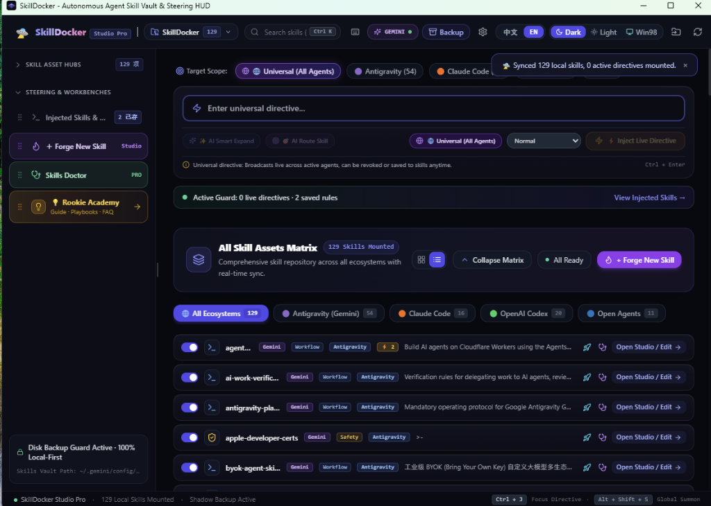
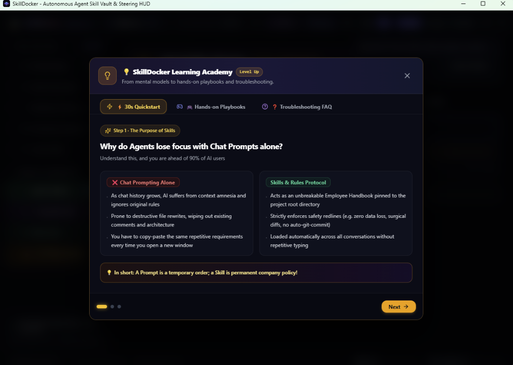
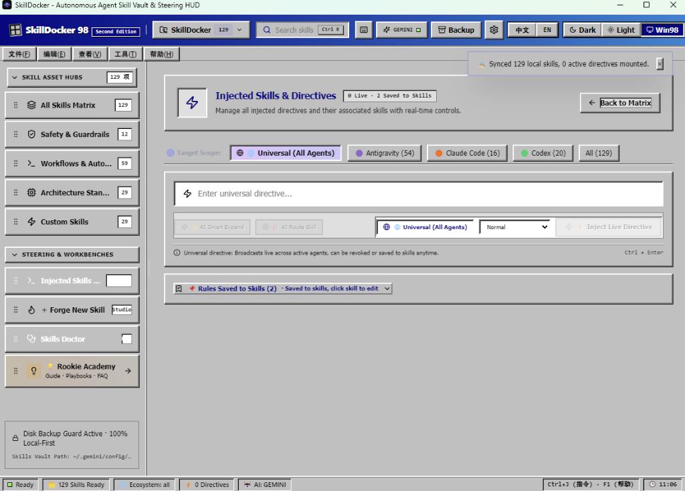
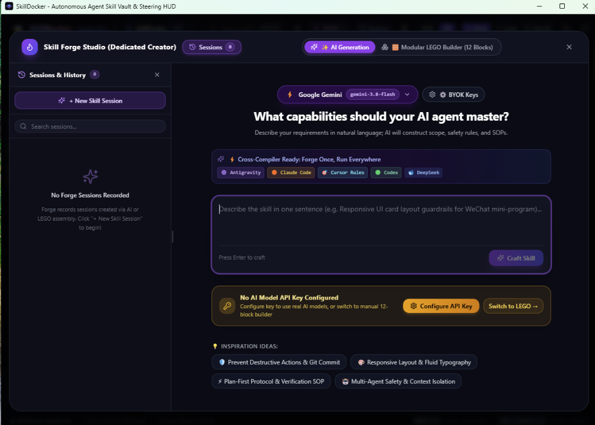

# SkillDocker 🛸

> **AI Skills新人友好的Skill管理，铸造，诊断，学习一体化的轻量管理器**  
> **A lightweight desktop floating dock to inspect, toggle, and hot-inject directives across Claude Code, Cursor, Antigravity, and Codex.**  
> *集中查看、一键开关、随时为正在运行的 AI 追加临时要求。纯本地离线运行，不上传代码。*

[](https://github.com/santiago0071/SkillDocker/releases)
[](LICENSE)
[](https://github.com/santiago0071/SkillDocker/releases)
[](https://v2.tauri.app/)

---



---

## 📖 这个工具解决什么实际问题？ / Problem Statement

日常用多个 AI 编程工具（比如 Claude Code、Google Antigravity、Codex、Cursor）时，本地往往积累了大量 Skills（散落在各个深层隐藏目录如 `~/.claude/skills`、`~/.gemini`、`~/.codex`、`.cursorrules`）。在日常写代码中，常常有两个非常烦人的实际痛点：

When working with multiple AI coding tools (Claude Code, Antigravity, Codex, Cursor), developers end up with dozens of Skills scattered across hidden dot-directories. Two real headaches constantly happen:

1. **看不见、记不清 (散落在深层目录，无法全局感知)**：
   Skills 藏在不同的文件夹里。开工时根本记不清当前到底有哪些 Skills 在生效，不同的 Skills 之间会不会相互冲突。
   *Skills are buried in different directories. It is hard to see what Skills are currently active and whether they contradict each other.*

2. **临时叮嘱容易忘，每次手动改文件太麻烦 (聊天提示词 vs 长期沉淀的 Skills)**：
   在聊天窗口里临时叮嘱 AI“这次只改前端，不要动后端接口”，会话一刷新或上下文一压缩，AI 扭头就忘了；而如果每次都手动去翻隐藏文件夹修改 Skill 文件，又很繁琐。
   *Telling the AI "don't touch backend" in chat gets forgotten once context compacts. But manually digging into hidden folders to update Skill files has too much friction.*



> *"A Prompt is a temporary order; a Skill is permanent company policy!"*  
> *“聊天里的 Prompt 只是随口交代的临时要求，写成文件沉淀下来的 Skill 才是长期执行的规章制度。”*

---

## ✨ 核心功能（它能帮你做什么？） / Core Capabilities

### 1. 🎛️ 集中查看与管理多工具 Skills (Visual Skills Cockpit)
* **自动扫描多工具 Skills**：自动识别本地 Claude Code、Google Antigravity、Codex 和 Cursor 项目里的所有 Skills，集中展示。
* **卡片式阅读与搜索**：不用手动翻隐藏目录，所有 Skills 用清晰卡片呈现，支持毫秒级全文检索与分类筛选。
* **一键开关**：点击按钮即可启用或停用某个 Skill，软件自动在后台切换，无需手动重命名文件。

### 2. ⚡ 随时呼出输入框，为 AI 追加临时要求 (Quick Directive Injector)
* **全局快捷键一键唤醒**：在写代码的任何时候按下 `Alt + Space`（macOS 为 `Option + Space`），立即呼出轻量小面板。
* **打一句白话，自动同步生效**：随手输入一句要求（例如“本次专注修复 bug，严禁改动任何公共接口”），软件自动把要求同步给当前 AI，防止 AI 上下文压缩后遗忘。

### 3. 🎨 两种主题风格：极客暗黑与 Win98 怀旧复古 (Adaptive Themes)
* **赛博暗黑驾驶舱**：高对比度、清晰直观的现代极客暗黑界面。
* **Windows 98 复古皮肤**：完整还原经典的灰白立体边框、复古像素图标与状态栏，给日常编程换个心情。



### 4. 🛠️ Skill Forge 技能工坊 (Visual Studio)
* **积木式拼接**：将角色设定、约束条件、触发词等模块化快速拼装成标准的 Skill 文件。
* **自带模型检查 (BYOK)**：填入自己的 API Key，即可调用大模型帮您检查 Skill 质量并给出润色建议。



### 5. 🛡️ 纯本地离线运行，绝不上传您的代码 (100% Local-First)
* **0 云端依赖**：所有 Skills 扫描、读取与修改只在您的本地电脑执行，绝无任何常驻云端服务，绝不上传您的项目代码与私密提示词。
* **离线永久使用**：商业版采用客户端本地非对称数字签名校验，断网也能永久正常使用。

---

## 📥 下载安装 / Download & Quick Start

请在 [GitHub Releases (v1.0.0)](https://github.com/santiago0071/SkillDocker/releases) 页面下载适合您操作系统的预编译安装包：

| 平台 / Platform | 安装包格式 / Package | 架构 / Architecture | 说明 / Notes |
|---|---|---|---|
| **Windows** | `.msi` / `.exe` | x64 (64-bit) | 双击运行安装向导，开箱即用 |
| **macOS** | `.dmg` | Apple Silicon (M1/M2/M3/M4) & Intel | 挂载后将应用拖拽入 Applications 目录 |

### 快捷唤醒 (Shortcut)
* **Windows**: `Alt + Space`
* **macOS**: `Option + Space`

---

## 🏛️ 版本划分 / Editions (Open-Core)

SkillDocker 采用国际成熟的 **Open-Core** 架构模式：

| 功能维度 / Feature | 社区开源版 (Community) | 商业专业版 (Pro) |
|---|:---:|:---:|
| 全生态多工具 Skill 扫描与 HUD 展示 | ✅ 支持 | ✅ 支持 |
| 全局快捷键呼出与通用指令热注入 | ✅ 支持 | ✅ 支持 |
| 赛博暗黑 HUD / Win98 复古怀旧等多套皮肤 | ✅ 支持 | ✅ 支持 |
| 纯本地白名单沙箱与离线运行 | ✅ 支持 | ✅ 支持 |
| L3 对抗性问题集与量化精准率基准测试 | ❌ | ✅ 专业版独占 |
| 跨 Skill 行为死锁与架构全景会诊 | ❌ | ✅ 专业版独占 |
| AI 一键靶向自动优化与写入确认 | ❌ | ✅ 专业版独占 |
| 授权形式 / Licensing | **MIT 开源免费** | **一次性买断 (永久离线可用)** |

> 商业版授权可在官方网站 [https://skilldocker.com/buy/](https://skilldocker.com/buy/) 获取（支持信用卡、PayPal、Apple Pay、Google Pay 等全球主流结算方式）。

---

## 🛡️ 本地质量门禁验证 (Engineering Verification)

本项目遵循严苛的工业级防呆与代码质量防线。所有提交均须通过本地 7 道核心自动化门禁：

```powershell
# 运行 7 道全量门禁 (TypeScript + ESLint + 单元测试 + 社区版物理隔离防泄密 + Rust Clippy + 64 项 Rust 单元测试)
powershell -ExecutionPolicy Bypass -File .\scripts\verify.ps1
```

门禁包含专门的物理隔离测试（`verify-community.ps1`），在拔除闭源模块的环境下独立构建并进行反泄漏二进制扫描（Anti-Leak Audit），确保开源社区版绝不夹带任何闭源残留。

---

## ☕ 赞助与支持 / Sponsor & Support

欢迎通过以下方式随缘支持：

If SkillDocker brings order and clarity to your daily agent workflow, any support for its continued independent maintenance is deeply appreciated:

### 1. 软件支持 / Commercial License
* 在官网获取 [SkillDocker Pro 商业买断授权](https://skilldocker.com/buy/)，享受完整深度诊断特性。

### 2. Ko-fi
* **Ko-fi**: [https://ko-fi.com/unistudio](https://ko-fi.com/unistudio) (支持信用卡 / PayPal / Apple Pay)

### 3. Crypto Donations (Direct On-Chain)

```text
Bitcoin (BTC):
1888z7bmtkwdj7PsFRG6Xctw4g4aJJjjZT

EVM Compatible (Ethereum, BNB Chain, Polygon, Arbitrum, Base - ETH / USDT / USDC):
0x888888F17960daF6f21847c0f9B3A9F5d52d3eEd

Solana (SOL / SPL Tokens):
88886b1EW3S9rNtbtaWmZoiz6H4A536cuUw9rRLhc7kn

Algorand (ALGO):
66666RUJ7XE76NKJIMS72JPXAFIFQNZGN6NYARGOKS4JFIML5ICBOTSFBM

NEAR Protocol:
8888618.near
```

### 4. 开源支持 / Open Source
* 点亮一颗 **Star 🌟**，或将它分享给身边正在被散乱 Prompt 困扰的朋友！

---

## 📄 许可证 / License

* 核心框架代码采用 [MIT License](LICENSE) 开源许可；
* Pro 商业扩展模块适用 [LICENSE-PRO](LICENSE-PRO) 专有商业许可。

Official Website: [https://skilldocker.com](https://skilldocker.com)
