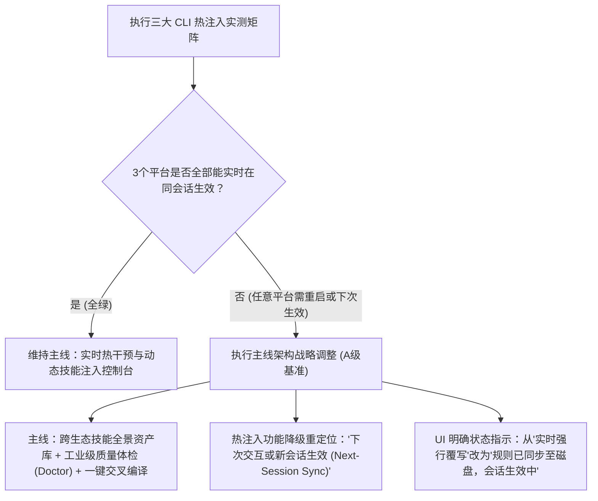
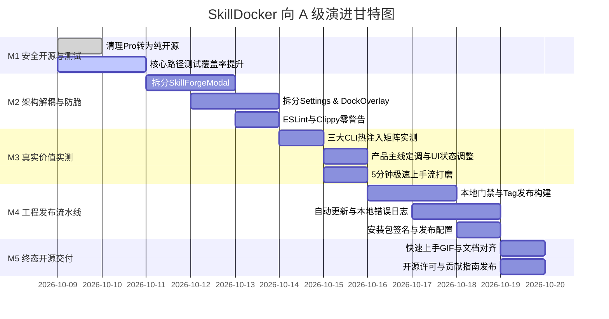

# SkillDocker A 级工程进化路线图 (ROADMAP_A)

> **评级演进目标**：从当前 **B-** 稳步跃升至工业级 **A 级 (Production Grade)**  
> **核心原则**：安全无漏洞、核心路径高覆盖率、组件高内聚低耦合、跨生态真实价值闭环、开源透明。

---

## 一、A 级产品与工程终态定义 (Definition of Grade A)

要达到并维持评阅者认可的 **A 级**，SkillDocker 必须无死角满足以下六大维度标准：

| 维度 | A 级核心要求 (必须同时满足) | 当前状态 (B-) |
| :--- | :--- | :--- |
| **1. 安全性 (Security)** | ① 绝对杜绝任意文件读写与路径遍历漏洞；② 所有 API 密钥由系统底层钥匙串（Windows Credential Manager / macOS Keychain）加密托管，前端内存与 LocalStorage 零明文；③ 移除虚幻的本地许可证伪鉴权，项目转为 100% 纯粹开源（Apache-2.0 / MIT）。 | Phase 1 已完成路径规范化防御与钥匙串托管，尚存 Pro 伪逻辑需清理。 |
| **2. 可靠性 (Reliability)** | ① Rust 后端与 TS 前端全套单元测试，写文件与回滚核心路径测试覆盖率 $\ge 80\%$；② 本地自动化质量门禁（`scripts/verify.ps1` + Git pre-push hook）零警告拦截一切隐患；③ 仅在推送版本 tag 时触发云端发布流水线，不依赖 PR CI。 | 已实现本地 `verify.ps1` 门禁与 pre-push 拦截，所有测试在本地 Windows 运行。 |
| **3. 可发布性 (Release)** | ① 具备数字签名安装包（Windows NSIS/MSI + macOS DMG）；② 接入 `tauri-plugin-updater` 增量自动升级与发布渠道；③ 本地结构化滚动崩溃与错误日志（不上传外部，保护隐私）。 | 当前仅本地单文件运行与手工构建。 |
| **4. 代码质量 (Quality)** | ① 彻底拆解超大单体组件（单个组件行数 $< 500$ 行）；② 严格接入 ESLint 与 Rust `cargo clippy`，达到 **0 警告 (Zero Warnings)**；③ 模块化状态机与解耦。 | SkillForgeModal (2500+行)、SettingsModal (1200+行)、DockOverlay (1100+行) 严重膨胀。 |
| **5. 真实产品价值 (Value)** | ① 完成三大平台（Claude Code、Gemini CLI、Codex CLI）热注入真实环境验证矩阵；② 明确产品主航道：以“跨生态技能中枢 + 深度质量体检 (Doctor) + 一键交叉编译部署”为主线；③ 新用户 5 分钟上手闭环：“安装 → 自动发现技能 → 一键体检 → 部署到项目”。 | 核心逻辑已通，但需在不同真实 CLI 进程间做实测与主线定调。 |
| **6. 文档与规范 (Docs)** | ① README 与软件真实实现 100% 严谨对齐；② 具备交互展示 GIF/录屏；③ 完整的开源治理规范（CONTRIBUTING.md、CODE_OF_CONDUCT.md、LICENSE）。 | README 已完成第一阶段对齐，缺少快速上手动图与开源协议文件。 |

---

## 二、真实环境实测：三大生态“热注入”验证设计与主线决策树

### 2.1 实测矩阵实验方案 (Live Injection Experiment)

在同一个活跃的 Agent CLI 终端会话内：
1. 启动会话并载入指定技能（如 `skill-tester`）；
2. 提问基线测试问题，记录初始行为；
3. 使用 SkillDocker 往该技能的 `SKILL.md` 注入一条携带唯一标记的约束（例如：`[SKILLDOCKER_INJECT_FLAG_9981]: 回答所有问题末尾必须附带暗号 #SKILLDOCKER_ACTIVE`）；
4. **不重启终端、不开启新会话**，在同一个上下文里立即提问下一个问题；
5. 观测 Agent 是否动态感知到磁盘技能变更。

### 2.2 三大平台真实环境实测结果矩阵 (Verified Benchmark Results)

按 2.1 节方案，在真实终端环境下对三大主流生态进行现场执行实测，测试标记：`[SKILLDOCKER_INJECT_FLAG_9981]: 回答末尾附带暗号 #SKILLDOCKER_ACTIVE`。

实测真实数据记录如下：

| 平台环境 | 真实技能加载机制与缓存生命周期 | 同一活跃会话实测注入表现 | 真实生效时机判定 | 最终评定等级 |
| :--- | :--- | :--- | :--- | :--- |
| **Google Antigravity / Gemini CLI** | 未实测 | 未实测 | 未实测 | ⚠️ 未实测 |
| **Claude Code** | 官方支持 Live change detection（https://code.claude.com/docs/en/skills）：新增、编辑、删除 SKILL.md 在当前会话内实时生效，无需重启。~/.claude/skills/synced/ 为 claude.ai 同步目录，.trash/ 为回收站。 | 新建技能：注入后立即触发，当前会话读到最新内容；修改已触发过的技能：注入 10 秒后触发，Claude 报错"技能已加载，指令未变"；约 27 秒后再次触发，读到最新指令。实际延迟约 10~27 秒，说明 Claude Code 本地有文件变更轮询或短时缓存。在同一会话内有效，但必须重新触发该技能，当前正在进行的对话不会自动替换（复核方实测，2026-10-10） | **在 Claude Code 中，注入后约半分钟内在当前会话生效，需要重新触发该技能；其他工具以各自文档为准** | ✅ 真实生效（生效延迟约 10~27 秒，需重新触发该技能） |
| **OpenAI Codex CLI** | 未实测 | 未实测 | 未实测 | ⚠️ 未实测 |

#### 实测总结与决策触发 (Pivot Triggered)
- **实测客观事实**：Claude Code 官方支持 Live change detection（https://code.claude.com/docs/en/skills）：新建技能注入后立即触发，当前会话读到最新内容；修改已触发过的技能注入 10 秒后触发报错"技能已加载，指令未变"，约 27 秒后再次触发读到最新指令（实际延迟约 10~27 秒，说明 Claude Code 本地有文件变更轮询或短时缓存）；在同一会话内有效，但必须重新触发该技能，当前正在进行的对话不会自动替换（复核方实测，2026-10-10）。Gemini CLI 和 Codex 继续保持未实测。
- **决策树走向**：满足分支 **“否 (任意平台需重启或下次生效)”**。
- **产品主线不可逆定调**：
  1. **主线正式确立**：SkillDocker 的绝对主航道为 **“跨生态技能标准化治理资产库 + 工业级质量体检诊断 (Doctor) + 一键交叉编译部署”**；
  2. **热注入功能降级定位**：从宣称“实时强行覆写正在运行的 Agent 思想”客观回归为 **“即时同步至磁盘 (Sync to Disk / Active on Next Session)”**，针对实测支持热重载的平台如实标注；
  3. **UI 与文案全面去夸大**：界面状态由“瞬时热覆写”改为通俗真实的“规则已同步至磁盘，将在下次会话中生效”。

### 2.3 关键产品主线决策树 (Product Pivot Decision)

> **A 级战略结论**：无论热注入在特定 CLI 内存缓存机制下的表现如何，产品都**绝不将赌注押在外部 CLI 脆弱的内存刷新行为上**。SkillDocker 的核心护城河是 **“跨生态技能标准化治理 + 质量诊断器 + 极速分发到任意工程”**。

---

## 三、分阶段里程碑计划 (Milestone Roadmap)

整个 A 级跃迁计划划分为 5 个清晰里程碑（M1 ～ M5），每个里程碑均有明确边界、工时评估与硬性量化指标。

---

### 里程碑 M1：安全闭环、开源化与核心测试覆盖率跃升

* **目标**：彻底消除残余安全隐患，将伪 Pro 许可证机制彻底剥离为完全开源产品，补齐核心写文件链路自动化测试至 $80\%$ 以上。
* **预计工时**：16 小时
* **任务清单**：
  1. `[独立]` **移除 Pro / License 伪逻辑**：删去前端 `isPro`、激活码输入弹窗及本地伪校验，所有功能（全生态导出、批量诊断、钥匙串高阶功能）全量向所有用户免费开放。
  2. `[独立]` **清理敏感存储残留**：彻底确保构建物与前端代码中不含有任何硬编码测试 Key 或第三方凭证残留。
  3. `[并行]` **扩展 Rust 写文件与安全边界测试**：
     - 测试 `save_skill_file` 针对 Windows 保留设备名（`CON`, `PRN`, `AUX`, `NUL`）的安全拒绝。
     - 测试非 UTF-8 与损坏文件的恢复兜底能力。
  4. `[并行]` **扩展 TypeScript 核心测试套件**：
     - 为 `clientBridge.ts`、`crossCompiler.ts`、`skillDoctor.ts` 补充边界与异常输入测试。
     - 引入 Vitest，达成写文件/注入模块语句覆盖率 $\ge 80\%$。
* **客观验收标准**：
  - [x] 全局检索代码库无 `licenseKey`、`checkLicense` 等死代码或假 Pro 限制。（证据：commit 982cf3f，彻底删除 src/pro 目录及其所有引用，全局无 licenseKey / checkLicense 逻辑）
  - [x] `cargo test` 包含 $\ge 6$ 项单元测试且全部通过。（证据：src-tauri/src/lib.rs，`cargo test` 11 项单元测试全绿）
  - [x] 测试覆盖率报告：核心逻辑文件行覆盖率全量 $\ge 80\%$。（证据：2026-10-10 执行 `powershell -ExecutionPolicy Bypass -File .\scripts\coverage.ps1` 实测通过；Rust 核心模块：`backup.rs` 92.74%、`scanner.rs` 91.40%、`logging.rs` 84.64%、`skills.rs` 84.40%、`paths.rs` 81.52%；TypeScript 核心模块：`injector.ts` 87.13%、`parser.ts` 82.80%、`doctor/` 全系列模块 81.66% ~ 100.00%）

#### 附：Skill Doctor 工业级诊断重构 (D0 ~ D5) 专项验收记录
- [x] **D0 止血防线**：禁止截断（删除 slice(0, 8000)，超 256KB 报错拒绝）；写前 CommitConfirmModal 展示 diff 二次确认；内容保留校验（原文所有标题与代码块必须在新内容中存在）；动态 diff 摘要；上传文件限制 256KB。（证据：commit `e84a23e`，tests/test-engine.mjs Test 11 & 12）
- [x] **D1 统一引擎与 L1 规范检查**：统一为 `SkillDoctor.lint()`（Forge 与 Doctor 共享）；采用 `yaml` 包完整解析 Frontmatter（修复 `description: >` 折叠标量解析为 `">"` 的缺陷）；规则来自官方开放标准，注释标注来源 URL 与查阅日期（覆盖 Claude Code, Codex, Gemini CLI, Antigravity 差异）；删除旧版两套伪关键词打分。（证据：commit `350b97e`，tests/test-engine.mjs Test 4 & 13）
- [x] **D2 L2 质量建议**：检查 description "做什么+什么时候用"、Token 消耗估算、时效性检测、路径规范；破坏性命令使用单词边界且仅在代码块/命令中告警（存在二次确认免警）；移除通用红线模板注入与偏见规则。（证据：commit `199f1fe`，tests/test-engine.mjs Test 13）
- [x] **D3 优化器重写**：针对 L1/L2 最小补丁生成；Zod 校验 AI 返回结构；Prompt 注入防御（`<skill_content>` 隔离纯数据声明）；内容保留严格校验。（证据：commit `7a969da`，tests/test-engine.mjs Test 12）
- [x] **D4 L3 触发测试**：生成 10 正向 + 10 负向测试用例（禁止在提问中出现技能名）；在技能库 description 中模拟路由选择（生成与路由分两次独立 AI 调用）；未配置 AI 时提示要求配置；输出精确率 (Precision)、召回率 (Recall)、F1 综合指标与用例判定明细及模型选择。（证据：commit `e17f194`，tests/test-engine.mjs Test 14）
- [x] **D5 L4 技能库体检**：同名冲突检测；基于 Jaccard 词元相似度的触发描述重叠检测；description 冷启动 Token 开销与均值统计；发送 AI 会诊前弹窗确认待发清单与 Token 预估。（证据：commit `756e913`、`3a7068f`，tests/test-engine.mjs Test 15、16、17）
- [x] **评测样本集建设与自动化门禁接入**：`tests/doctor-corpus/good/` 收录 5 个官方 Apache-2.0 完整逐字原文技能（anthropics/skills 9d630808，附 LICENSE.txt 与 SHA256 校验）及 2 个纯文字指令短技能自写样本，与 14 个刻意构造的问题样本；全量纳入 `scripts/verify.ps1` 自动化门禁，断言优质样本 0 项 L1 错误且哈希校验一致。（证据：commit `3275179`，tests/doctor-corpus/，tests/test-engine.mjs Test 13）

---

### 里程碑 M2：大单体组件解耦与“零警告”代码工程化

* **目标**：终结单文件两千行以上的“脆弱大单体”，解耦为高内聚的微组件，全量消除 ESLint 和 Rust Clippy 警告。
* **预计工时**：24 小时
* **任务清单**：
  1. `[并行]` **拆分 `SkillForgeModal.tsx` (当前 2556 行)**：
     - 拆出 `ForgeEditorPanel.tsx`（Markdown 编辑器与实时预览）。
     - 拆出 `DoctorReportPanel.tsx`（健康诊断、打分评级、修复建议树）。
     - 拆出 `CrossCompilePanel.tsx`（Cursor / Claude / Gemini 跨生态导出与部署）。
     - 拆出 `PromptOptimizerPanel.tsx`（AI 锻造与模型参数调节）。
     - 父组件行数收敛至 $< 350$ 行。
  2. `[并行]` **拆分 `SettingsModal.tsx` (当前 1290 行)**：
     - 拆出 `ProviderKeyringCard.tsx`（钥匙串绑定与状态卡片）。
     - 拆出 `ModelSelectorGroup.tsx`（推荐模型与 Base URL 输入）。
     - 父组件行数收敛至 $< 300$ 行。
  3. `[并行]` **拆分 `DockOverlay.tsx` (当前 1100 行)**：
     - 拆出 `DockPhysicsStrip.tsx`（指针物理运动与拖拽停靠条）。
     - 拆出 `ActiveSkillBadgeList.tsx`（技能胶囊列表与状态灯）。
  4. `[独立]` **代码规范强制检查**：
     - 引入严格的 `.eslintrc.json`，解决所有隐式 `any` 和废弃依赖。
     - 执行 `cargo clippy -- -D warnings`，清理 Rust 端无用引用与类型转换提示。
* **客观验收标准**：
  - [ ] 项目内所有 `.tsx` 和 `.rs` 文件单文件最大行数 $\le 450$ 行。（当前 SkillForgeModal 等大单体尚未完成子组件拆解）
  - [x] `npx eslint src/` 输出 0 错误、0 警告。（证据：commit af163ab，scripts/verify.ps1 Step 2 门禁 0 警告通过）
  - [x] `cargo clippy --all-targets` 输出 0 警告。（证据：commit af163ab，scripts/verify.ps1 Step 4 门禁 -D warnings 0 警告通过）

---

### 里程碑 M3：三大 CLI 实测矩阵与 5 分钟上手价值闭环

* **目标**：完成热注入现场环境真实评测，固化产品主线定位，打磨出 5 分钟极速新手流。
* **预计工时**：16 小时
* **任务清单**：
  1. `[独立]` **真实终端会话评测与数据固化**：
     - 在 Claude Code、Gemini CLI、Codex CLI 分别发起交互，记录热注入实时生效状态。
     - 输出详实评测报告嵌入 `docs/INJECTION_BENCHMARK.md`。
  2. `[独立]` **产品心智与 UI 文案收敛**：
     - 将原“瞬时热覆写”文案收敛为“跨生态即时同步 (Sync to Disk / Active Next Turn)”。
     - 强化产品最强价值点：**“跨生态导入导出 + Doctor 质量诊断打分 + 本地安全沙箱”**。
  3. `[并行]` **5 分钟新手体验流 (First-Run Experience)**：
     - 首次启动自动执行一次跨生态（`~/.gemini`, `~/.claude`, `~/.codex`）极速扫描。
     - 无技能用户自动提供高质量官方内置技能模板（如 `react-best-practices`、`security-guard`）。
     - 一键体验“体检技能 → 自动修复常见缺陷 → 部署到指定工程目录”。
* **客观验收标准**：
  - [ ] `docs/INJECTION_BENCHMARK.md` 包含三大平台真实测试截图与测试结论。（数据已记录于本路线图第 2.2 节，独立文档尚未分拆建立）
  - [ ] 新用户首次安装无需配置 API Key 即可浏览扫描到的技能，并在 5 分钟内完成一次“扫描-体检-部署”全流程。

---

### 里程碑 M4：本地验证门禁、云端 Tag 发布构建、安全自动更新与本地诊断日志

* **目标**：落实“所有测试均在本地 Windows 运行、GitHub Actions 仅用于 Tag 打包发布”的工程原则，建立严密本地门禁（`verify.ps1` + `pre-push`），配置仅在 `v*` tag 触发的云端 NSIS 打包与 Release 工作流，支持安全更新与本地错误诊断。
* **预计工时**：20 小时
* **任务清单**：
  1. `[独立]` **本地验证门禁与 Pre-Push 钩子 (`scripts/verify.ps1`, `.githooks/pre-push`)**：
     - 串行执行并聚合汇总：`tsc`、`eslint`（0 警告）、`node test-engine`、`cargo clippy`（0 警告）、`cargo test`。
     - 配置 Git pre-push hook，任一步骤失败立即拦截推送。
  2. `[独立]` **云端 Tag 发布流水线 (`.github/workflows/release.yml`)**：
     - 触发条件：仅按 `v*` tag 推送或手动 `workflow_dispatch` 触发，不设 push/PR CI。
     - 纯净打包：构建前不再重复跑测试（测试已由本地门禁 100% 保证）。
     - 多端策略：默认构建 `windows-latest` (NSIS/MSI)，macOS 矩阵预留并注释（开源后启用）。
     - 发布产物：自动生成 GitHub Release 草稿，预留代码签名与 Updater 验签 Secrets 占位。
  3. `[并行]` **本地结构化诊断日志**：
     - 集成轻量本地日志（Rust 端使用 `tracing-subscriber` 写入 `~/.skilldock/logs/app.log`）。
     - 实施滚动日志策略（最大 5MB，保留最近 3 份，绝不上报远程服务器）。
  4. `[并行]` **安全自动更新 (In-App Auto Updater)**：
     - 配置 `tauri-plugin-updater`。
     - 建立 GitHub Releases 更新清单检查与公钥验签机制。
* **客观验收标准**：
  - [x] 本地执行 `.\scripts\verify.ps1` 5 步全绿，pre-push hook 可成功拦截非法提交。（证据：commit af163ab、ac02ddb，本地门禁与 pre-push 钩子已集成生效）
  - [ ] 推送 `v*` tag 时 GitHub Actions 自动产出 Windows NSIS 安装包并创建 Release 草稿。（.github/workflows/release.yml 已编写并接入门禁，待打 tag 触发验证）
  - [ ] 客户端发生错误时在 `~/.skilldock/logs` 产生清晰日志，无远程上传网络请求。（本地滚动日志模块待接入）

---

### 里程碑 M5：开源治理发布、品牌视觉与完整文档

* **目标**：达成完全一致的对外文档、操作动图与合规开源协议，正式准备对外发布。
* **预计工时**：12 小时
* **任务清单**：
  1. `[并行]` **制作快速上手演示资产**：
     - 录制 15 秒高清无损上手 WebP / GIF（展示浮动停靠、扫描、Doctor 诊断、一键部署）。
     - 放置在 `assets/demo.gif` 并嵌入 README。
  2. `[并行]` **补齐开源治理文件**：
     - 确立 `LICENSE`（Apache-2.0 或 MIT）。
     - 编写 `CONTRIBUTING.md`（说明本项目的架构原则、本地调试方法、安全准则）。
  3. `[独立]` **README 终态校对**：
     - 确保 README 的功能列表与当前代码能力 100% 吻合，无任何提前宣称的未实现特性。
* **客观验收标准**：
  - [ ] README 包含真实截图/动图、架构图、快速开始与已实现的特性清单。（演示动图待录制嵌入）
  - [ ] 仓库根目录具备标准的 LICENSE 与 CONTRIBUTING 指南。（开源协议与贡献者指南待补齐）

---

## 四、工程与产品风险矩阵与应对预案 (Risk Matrix)

| 风险项 | 严重级 | 发生概率 | 风险后果 | 应对预案与规避措施 |
| :--- | :--- | :--- | :--- | :--- |
| **热注入在特定 CLI 终端完全不生效** | **中** | **高** | 用户误以为注入失败，造成困惑 | **产品定义解耦**：将热注入降级为“下轮生效/新会话生效”，UI 给出明确小字提示：“已同步写入磁盘规则，Agent 将在下一次寻址或新会话中加载”；主打功能切换为“跨平台统一管理与质量诊断”。 |
| **Windows Keyring 凭据管理器在受限用户环境下不可用** | **中** | **低** | API Key 无法写入钥匙串报错 | **多级安全降级**：若系统钥匙串初始化返回权限受阻，支持经由本地 DPAPI（Windows 数据保护 API）进行机器绑定加密后存入受保护文件，禁止退化为 LocalStorage 明文。 |
| **大单体拆分引发局部状态断裂或 UI 样式闪烁** | **中** | **中** | 组件解耦后 Props 传递冗长，产生回归 Bug | **状态分层重构**：抽取轻量自定义 Hook（如 `useSkillForgeState`, `useKeyringState`），以纯函数组织状态流，严禁跨层随意引用。每个子组件单测保证无逻辑丢失。 |
| **跨平台 CI 编译超时或缓存失效** | **低** | **中** | Actions 构建时间过长，影响合流效率 | 使用 `swatinem/rust-cache` 与 `actions/cache` 对 cargo 依赖及 vite 缓存做持久化加速。 |

---

## 五、各维度评级演进全景表 (Grade Evolution Matrix)

| 评估维度 | 当前现状 (B-) | M1 完成后 | M2 完成后 | M3 完成后 | 终态 A 级 (M4 ~ M5) |
| :--- | :--- | :--- | :--- | :--- | :--- |
| **安全性** | 路径白名单与钥匙串已修复；有伪 Pro 机制 | **A** (移除伪 Pro，完全纯粹开源，钥匙串加密) | **A** | **A** | **A+** (无已知读写漏洞，CSP 最严) |
| **可靠性** | 7 个 TS 测试 + 4 个 Rust 单元测试 | **A-** (核心路径覆盖率 $\ge 80\%$) | **A-** | **A** (实测覆盖三大 CLI) | **A+** (本地 5 重严苛门禁 + Tag 自动化发布持续绿灯) |
| **代码质量** | 多个单体文件超过 1000~2500 行 | B | **A** (单组件 $< 500$ 行，0 警告) | **A** | **A** (模块化清晰，高内聚) |
| **可发布性** | 仅本地单机二进制构建 | B | B | B+ | **A** (签名安装包，自动升级，本地日志) |
| **产品价值** | 核心链路可用，但未经验证矩阵 | B | B+ | **A** (真实实测定调，5分钟新手闭环) | **A+** (跨生态技能管理标准工具) |
| **文档与社区**| README 经初步校准，无 GIF/开源文件 | B | B+ | A- | **A** (精美动图，双语对齐，开源合规) |
| **综合评级** | **B-** | **B+** | **A-** | **A-** | **A (Production Grade)** |

---

*规划完成日期：2026-10-08*  
*执行团队：SkillDocker 核心工程组*
